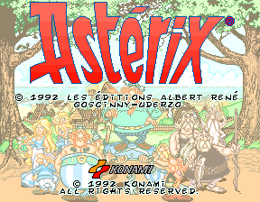

# Asterix — Analogue Pocket openFPGA

Standalone **Asterix (Konami, 1992), World EAD** for Analogue Pocket, by **mmmax4**.
Based on [jlrh/konami-fpga](https://github.com/jlrh/konami-fpga),
[JTCORES/JTFRAME](https://github.com/jotego/jtcores), and the Pocket integration
from [MooBucky / plasticbugs](https://github.com/plasticbugs/moomesa).



## Install

1. Copy the release's **Cores**, **Platforms** and **Assets** folders to the SD root.
2. Build the ROM image from your own complete MAME **asterix / World EAD** ZIP:

   ```sh
   python3 scripts/build_rom.py /path/to/asterix.zip --output private/asterix.rom
   python3 scripts/verify_rom.py /path/to/asterix.zip private/asterix.rom
   ```

3. Copy `asterix.rom` to `Assets/asterix/mmmax4.asterix/` on the SD.
4. Close/reopen the core and launch **Arcade → Asterix**. The game loads automatically.

The release contains **no game ROM, EEPROM dump or save**. The Python standard-library
builder/verifier checks all eleven required original dumps by size, CRC32 and SHA1,
including the factory EEPROM. Only World EAD is supported. Keep an existing
`asterix.sav`; see [installation and recovery](docs/INSTALL.md).

## Controls


| Pocket | Game |
| --- | --- |
| D-pad | Move |
| B / X | Punch |
| A / Y | Jump |
| Select | Coin |
| Start | Start / select |

Dock supports two players. Test and Service buttons start Unassigned; optional
assignments and Test Switch (hold) are in the core menu. Cabinet settings use
the original EEPROM-backed Test menu. Arcade 4:3 is default; Fill screen uses 10:9.

## Version 0.1.2

Historical playable baseline. The KONAMI logo animation and speech still have known issues.
For installation, use the [latest 0.1.4 release](https://github.com/mmmax4/openFPGA-Asterix/releases/tag/v0.1.4).
Versions 0.1.2 and 0.1.3 are available as historical releases; see [changelog](CHANGELOG.md).

Pocket tests on OS 2.7 confirmed gameplay through level 2 on the earlier baseline,
EEPROM initialization, direct startup and cabinet-setting persistence.
Speech improved substantially in 0.1.3 comparisons; some mild distortion may remain.
High-score persistence is **not supported**: only the 128-byte cabinet EEPROM is
saved. Full-game completion and every two-player Dock action have not been
exhaustively verified. See [validation scope](docs/VALIDATION.md).

The package includes the original platform marquee and a Pocket title screenshot.
Game names, characters and artwork remain their respective owners' works and
are separate from the software license terms. Private recordings and messages
are not bundled.

See [build instructions](docs/BUILD.md), [credits](CREDITS.md),
[licensing](LICENSING.md) and [provenance](docs/PROVENANCE.json).
